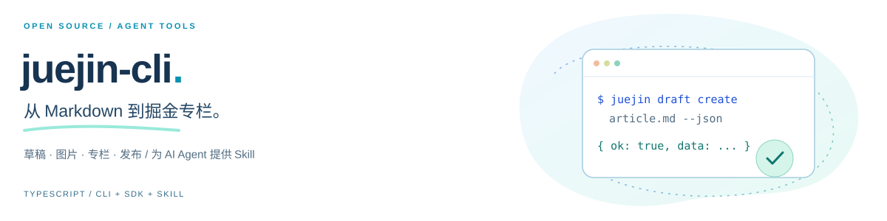
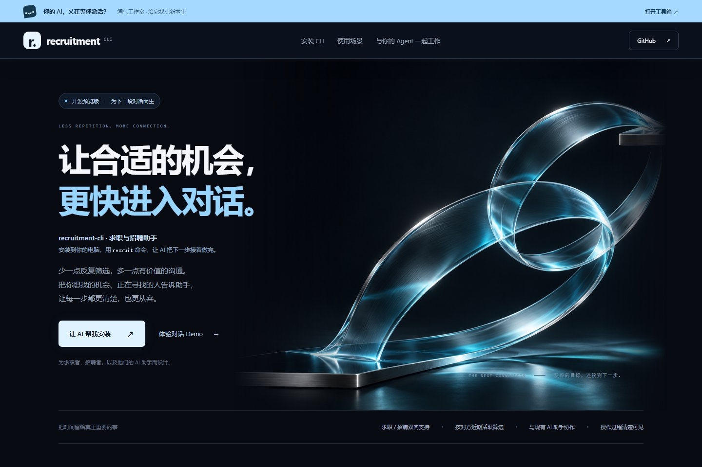

  

  <strong>从交互界面到 Agent Runtime，把想法做成完整的产品。</strong> 
  TypeScript / React / Node.js · Desktop / Web / Mobile

  <a href="https://catbuddy.ganzhibin.icu/"><strong>catbuddy ↗</strong></a> &nbsp;&nbsp; / &nbsp;&nbsp;
  <a href="https://flowing-resume.ganzhibin.icu/"><strong>流萤简历 ↗</strong></a> &nbsp;&nbsp; / &nbsp;&nbsp;
  <a href="https://next.ganzhibin.icu/"><strong>淘气工具铺 ↗</strong></a> &nbsp;&nbsp; / &nbsp;&nbsp;
  <a href="https://juejin.cn/user/3806962499980916/posts"><strong>技术写作 ↗</strong></a> &nbsp;&nbsp; / &nbsp;&nbsp;
  <a href="https://gitee.com/luli1314520"><strong>Gitee ↗</strong></a>

  <strong>WeChat / 微信</strong> &nbsp; <code>wxid_bnx635aq9b1j22</code>

 

### 01 &nbsp; / &nbsp; SELECTED WORK

<table>
  <thead>
    <tr>
      <th align="left">项目</th>
      <th align="left">介绍与入口</th>
    </tr>
  </thead>
  <tbody>
    <tr>
      <td width="40%" valign="top">
         
        <strong>catbuddy</strong> 
        AI Coding · Agent Runtime
      </td>
      <td valign="top">
        <strong>把 AI 编程助手做成一套系统。</strong>  
        共享 UI 连接桌面 Runtime，Gateway 协调跨端会话；执行引擎管理上下文、工具调用、长期记忆和任务生命周期。  
        <a href="https://catbuddy.ganzhibin.icu/">体验官网 ↗</a> · <a href="https://github.com/Ganzhib/catbuddy#architecture">系统架构 ↗</a> · <a href="https://github.com/Ganzhib/catbuddy#agent-runtime">Agent 引擎 ↗</a> · <a href="https://github.com/Ganzhib/catbuddy">源码 ↗</a>
      </td>
    </tr>
    <tr>
      <td width="40%" valign="top">
         
        <strong>流萤简历</strong> 
        AI Resume · Career Product
      </td>
      <td valign="top">
        <strong>你的经历，与 AI 一起写得更好。</strong>  
        围绕真实经历，串联简历编辑与 Agent 协作、可继续编辑的 AI 文档、面试练习及多格式导出，通过 AI 连接器接入熟悉的工作流。  
        <a href="https://flowing-resume.ganzhibin.icu/">体验官网 ↗</a> · <a href="https://flowing-resume.ganzhibin.icu/zh#features">编辑与生成 ↗</a> · <a href="https://flowing-resume.ganzhibin.icu/zh#ai-practice">AI 求职准备 ↗</a>
      </td>
    </tr>
    <tr>
      <td width="40%" valign="top">
         
        <strong>juejin-cli</strong> 
        Open Source · CLI / SDK / Skill
      </td>
      <td valign="top">
        <strong>从 Markdown 到掘金专栏。</strong>  
        面向开发者与 AI Agent 的掘金开源 CLI，支持文章搜索、Markdown 草稿、图片上传、专栏管理与发布。提供结构化 JSON、命令能力查询和自动安装的 Skill。  
        <a href="https://github.com/Ganzhib/juejin-cli">源码 ↗</a> · <a href="https://ganzhib.github.io/juejin-cli/">安装与场景 ↗</a> · <a href="https://github.com/Ganzhib/juejin-cli/blob/main/docs/ARCHITECTURE.md">架构设计 ↗</a>
      </td>
    </tr>
    <tr>
      <td width="40%" valign="top">
         
        <a href="https://github.com/Ganzhib/wemedia-cli"><strong>wm · WeMedia</strong></a> 
        Open Source · CLI / AI Publishing
      </td>
      <td valign="top">
        <strong>把时间留给创作，把发布交给 wm。</strong>  
        面向 AI Agent 的多平台自媒体发布 CLI，支持微信公众号、小红书、掘金与知乎，串联内容排版、图片上传、草稿管理、发表与结果查询。各平台按自身能力提供支持，账号登录状态保存在本机。  
        <a href="https://github.com/Ganzhib/wemedia-cli">源码 ↗</a> · <a href="https://ganzhib.github.io/wemedia-cli/">安装与场景 ↗</a> · <a href="https://github.com/Ganzhib/wemedia-cli/blob/main/docs/AI_USAGE.md">AI 使用指导 ↗</a>
      </td>
    </tr>
    <tr>
      <td width="40%" valign="top">
         
        <a href="https://github.com/Ganzhib/recruitment-cli"><strong>recruitment-cli</strong></a> 
        Open Source · CLI / SDK / AI Recruitment
      </td>
      <td valign="top">
        <strong>让合适的机会，更快进入对话。</strong>  
        面向 AI 助手的求职与招聘工具，支持 BOSS 直聘岗位搜索、推荐候选人筛选与近期活跃度过滤，串联沟通计划、执行和回执；也可读取公司官网的公开职位。提供 CLI、SDK 与本地 AI 对话 Demo，账号登录状态保存在本机。  
        <a href="https://github.com/Ganzhib/recruitment-cli">源码 ↗</a> · <a href="https://ganzhib.github.io/recruitment-cli/">体验官网 ↗</a> · <a href="https://ganzhib.github.io/recruitment-cli/demo/">对话 Demo ↗</a> · <a href="https://github.com/Ganzhib/recruitment-cli/blob/main/docs/GETTING_STARTED.md">接入指南 ↗</a>
      </td>
    </tr>
    <tr>
      <td width="40%" valign="top">
         
        <strong>淘气桌宠</strong> 
        Desktop · Local First
      </td>
      <td valign="top">
        <strong>给桌面留一点陪伴。</strong>  
        以咕咕嘎嘎小男孩为主角的免费桌面伙伴，支持互动、专注计时和本地宠物工坊，打磨透明窗口、交互状态与本地数据体验。  
        <a href="https://github.com/Ganzhib/taoqi-pet">源码 ↗</a> · <a href="https://ganzhib.github.io/taoqi-pet/">下载体验 ↗</a>
      </td>
    </tr>
    <tr>
      <td width="40%" valign="top">
         
        <strong>小账兜</strong> 
        Mobile · AI Bookkeeping
      </td>
      <td valign="top">
        <strong>把 AI 放进日常。</strong>  
        自然语言驱动的移动端记账应用。从 React Native 界面到 Express 服务、身份认证与 PostgreSQL 存储，串起 AI 解析和账单管理的完整链路。  
        <a href="https://github.com/Ganzhib/ai-bill-rn">源码 ↗</a>
      </td>
    </tr>
  </tbody>
</table>

 

### 02 &nbsp; / &nbsp; ENGINEERING FOCUS

- **Agent Systems** · 显式生命周期、上下文预算与压缩、工具编排、长期记忆、MCP / Skills
- **Cross-platform** · 共享 React UI、IPC / HTTP / WebSocket 传输、Gateway 会话协调、桌面与移动端入口
- **Product Engineering** · 交互与状态设计、认证与数据链路、本地持久化、桌面打包与更新

关心功能背后的**职责边界、状态和生命周期**，也关心用户点下按钮后的每一步体验。

 

### 03 &nbsp; / &nbsp; TOOLBOX

**Languages &amp; UI** &nbsp; <code>TypeScript</code> <code>JavaScript</code> <code>React</code> <code>Tailwind CSS</code> <code>Vite</code>

**Desktop &amp; Mobile** &nbsp; <code>Electron</code> <code>React Native</code> <code>Expo</code>

**Server &amp; Data** &nbsp; <code>Node.js</code> <code>Fastify</code> <code>Express</code> <code>PostgreSQL</code> <code>MySQL</code>

 

---

  <strong>Build with intent. Ship with care.</strong> 
  保持好奇，把下一件作品做好。 · <a href="https://juejin.cn/user/3806962499980916/posts">在掘金记录构建过程 ↗</a>

