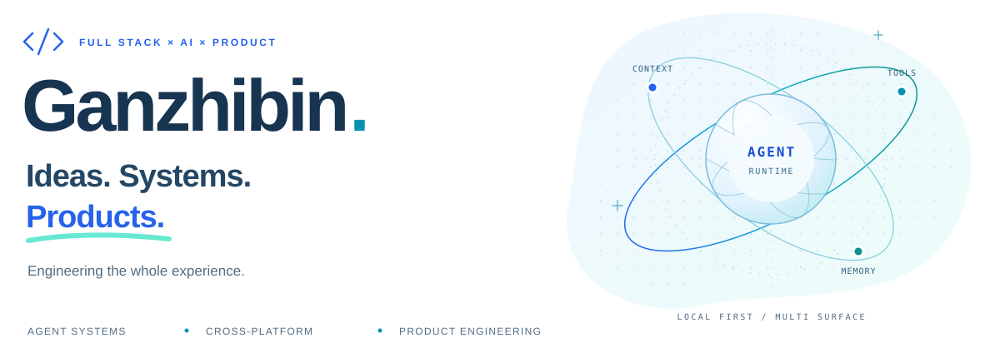
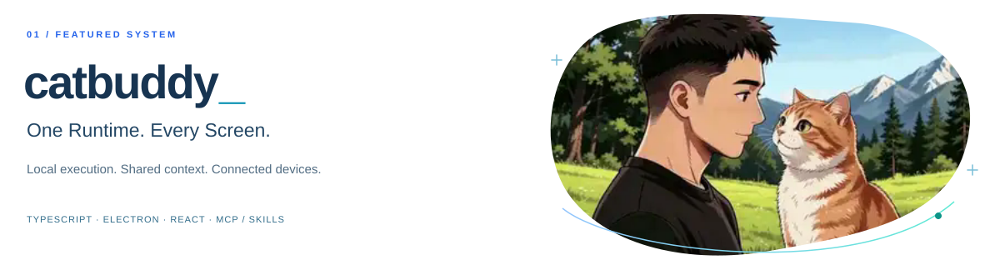
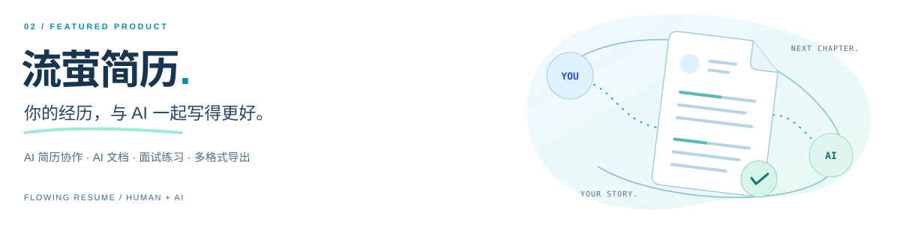
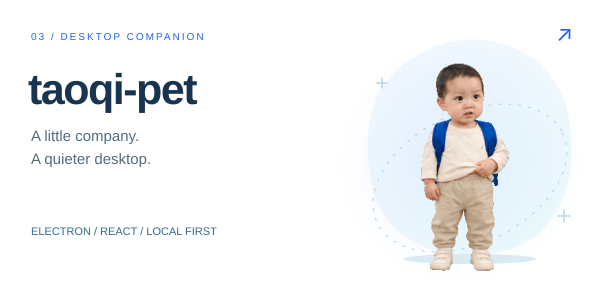
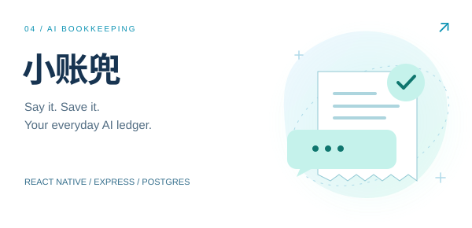

  

  <strong>从交互界面到 Agent Runtime，把想法做成完整的产品。</strong> 
  TypeScript / React / Node.js · Desktop / Web / Mobile

  <a href="https://catbuddy.ganzhibin.icu/"><strong>catbuddy ↗</strong></a> &nbsp;&nbsp; / &nbsp;&nbsp;
  <a href="https://flowing-resume.ganzhibin.icu/"><strong>流萤简历 ↗</strong></a> &nbsp;&nbsp; / &nbsp;&nbsp;
  <a href="https://next.ganzhibin.icu/"><strong>淘气工具铺 ↗</strong></a> &nbsp;&nbsp; / &nbsp;&nbsp;
  <a href="https://juejin.cn/user/3806962499980916/posts"><strong>技术写作 ↗</strong></a> &nbsp;&nbsp; / &nbsp;&nbsp;
  <a href="https://gitee.com/luli1314520"><strong>Gitee ↗</strong></a>

 

### 01 &nbsp; / &nbsp; SELECTED WORK

**catbuddy · 把 AI 编程助手做成一套系统。** 共享 UI 通过不同传输层连接桌面 Runtime，Gateway 协调跨端会话；执行引擎管理上下文、工具调用、长期记忆和任务生命周期。

<a href="https://catbuddy.ganzhibin.icu/">体验官网 ↗</a> &nbsp; · &nbsp; <a href="https://github.com/Ganzhib/catbuddy#architecture">系统架构 ↗</a> &nbsp; · &nbsp; <a href="https://github.com/Ganzhib/catbuddy#agent-runtime">Agent 引擎 ↗</a> &nbsp; · &nbsp; <a href="https://github.com/Ganzhib/catbuddy">浏览源码 ↗</a>

 

**流萤简历 · 你的经历，与 AI 一起写得更好。** 我的 AI 求职产品，围绕真实经历，串联简历编辑与 Agent 协作、可继续编辑的 AI 文档、面试练习及多格式导出。通过 AI 连接器，把简历、资料和求职准备接入熟悉的 AI 工作流。

<a href="https://flowing-resume.ganzhibin.icu/">体验官网 ↗</a> &nbsp; · &nbsp; <a href="https://flowing-resume.ganzhibin.icu/zh#features">编辑与生成 ↗</a> &nbsp; · &nbsp; <a href="https://flowing-resume.ganzhibin.icu/zh#ai-practice">AI 求职准备 ↗</a>

 

  
  

**淘气桌宠 · 给桌面留一点陪伴。** 以咕咕嘎嘎小男孩为主角的免费桌面伙伴，支持互动、专注计时和本地宠物工坊。围绕透明窗口、交互状态、本地数据与应用更新，打磨完整的桌面体验。

<a href="https://github.com/Ganzhib/taoqi-pet">浏览源码 ↗</a> &nbsp; · &nbsp; <a href="https://ganzhib.github.io/taoqi-pet/">下载体验 ↗</a>

**小账兜 · 把 AI 放进日常。** 自然语言驱动的移动端记账应用。从 React Native 界面到 Express 服务、身份认证与 PostgreSQL 存储，串起 AI 解析和账单管理的完整链路。

<a href="https://github.com/Ganzhib/ai-bill-rn">浏览源码 ↗</a>

 

### 02 &nbsp; / &nbsp; ENGINEERING FOCUS

- **Agent Systems** · 显式生命周期、上下文预算与压缩、工具编排、长期记忆、MCP / Skills
- **Cross-platform** · 共享 React UI、IPC / HTTP / WebSocket 传输、Gateway 会话协调、桌面与移动端入口
- **Product Engineering** · 交互与状态设计、认证与数据链路、本地持久化、桌面打包与更新

关心功能背后的**职责边界、状态和生命周期**，也关心用户点下按钮后的每一步体验。

 

### 03 &nbsp; / &nbsp; TOOLBOX

**Languages &amp; UI** &nbsp; <code>TypeScript</code> <code>JavaScript</code> <code>React</code> <code>Tailwind CSS</code> <code>Vite</code>

**Desktop &amp; Mobile** &nbsp; <code>Electron</code> <code>React Native</code> <code>Expo</code>

**Server &amp; Data** &nbsp; <code>Node.js</code> <code>Fastify</code> <code>Express</code> <code>PostgreSQL</code> <code>MySQL</code>

 

---

  <strong>Build with intent. Ship with care.</strong> 
  保持好奇，把下一件作品做好。 · <a href="https://juejin.cn/user/3806962499980916/posts">在掘金记录构建过程 ↗</a>

