  

  <strong>全栈开发 · AI 应用 · 桌面与移动端</strong> 
  喜欢把想法做成能用的产品，也在意每一次点击的体验。

  <a href="https://next.ganzhibin.icu/">淘气工具铺</a> &nbsp; / &nbsp;
  <a href="https://resume.ganzhibin.icu/">流萤简历</a> &nbsp; / &nbsp;
  <a href="https://juejin.cn/user/3806962499980916/posts">掘金博客</a> &nbsp; / &nbsp;
  <a href="https://gitee.com/luli1314520">Gitee</a>

 

### 关于我

我是 Ganzhibin，喜欢做有实际用途、也有一点趣味的应用。

- **从界面到服务端**：用 React、TypeScript 和 Node.js 串起完整的产品体验。
- **把 AI 接进工作流**：探索 Agent Runtime、工具调用和跨设备协同，让 AI 能参与具体任务。
- **也做一些小而有趣的东西**：桌面宠物、移动端记账，以及日常用得上的工具。
- **边做边记录**：在 [掘金](https://juejin.cn/user/3806962499980916/posts) 分享学习和实践。

 

### 最近在做的作品

<table>
  <tr>
    <td width="33%" valign="top">
      <h3>01 / catbuddy</h3>
      
<strong>One Runtime. Every Screen.</strong>

      
桌面优先的 AI 编程助手。把本地执行、工具调用、长期记忆和跨端会话连接起来，从桌面、浏览器和手机进入同一套工作流。

      
<code>TypeScript</code> <code>Electron</code> <code>React</code>

      
<a href="https://github.com/Ganzhib/catbuddy">查看源码 →</a>

    </td>
    <td width="33%" valign="top">
      <h3>02 / 淘气桌宠</h3>
      
<strong>你忙它陪，你摸它回。</strong>

      
一只轻量、免费的桌面小伙伴。支持互动、换装、专注计时和本地宠物工坊，让桌面多一点陪伴，也留一点安静。

      
<code>Electron</code> <code>React</code> <code>Vite</code>

      
<a href="https://github.com/Ganzhib/taoqi-pet">查看源码 →</a> &nbsp; <a href="https://ganzhib.github.io/taoqi-pet/">下载体验 ↗</a>

    </td>
    <td width="33%" valign="top">
      <h3>03 / 小账兜</h3>
      
<strong>聊一句，记一笔。</strong>

      
通过自然语言对话记录账单的移动应用。从 AI 解析、用户认证到数据存储，实践一套完整的移动端与服务端链路。

      
<code>React Native</code> <code>Express</code> <code>PostgreSQL</code>

      
<a href="https://github.com/Ganzhib/ai-bill-rn">查看源码 →</a>

    </td>
  </tr>
</table>

 

### 常用技术

| 方向 | 工具与技术 |
| :--- | :--- |
| 界面与交互 | TypeScript · React · Tailwind CSS · Vite |
| 桌面与移动端 | Electron · React Native · Expo |
| 服务端与数据 | Node.js · Express · Fastify · PostgreSQL · MySQL |
| AI 与工具 | Agent Runtime · MCP · LLM 工具调用 |

 

  保持好奇，把下一件小事做好。 Stay curious. Keep building.

